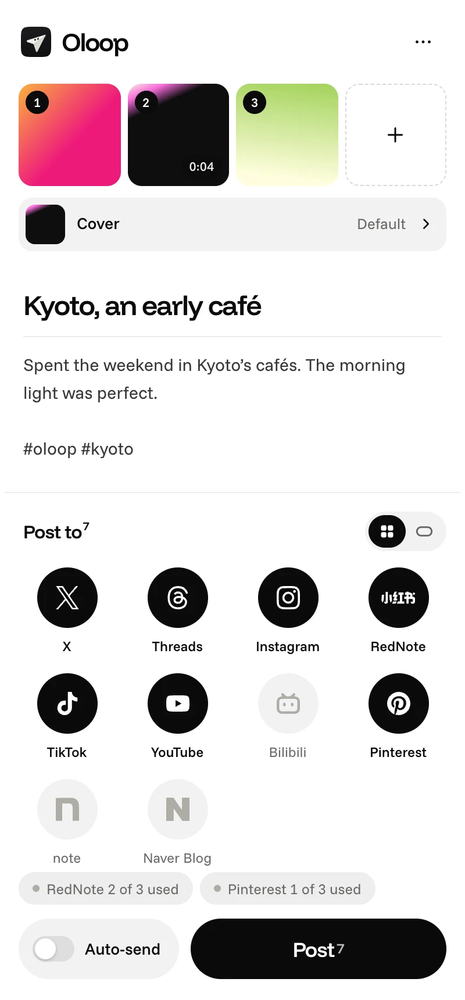
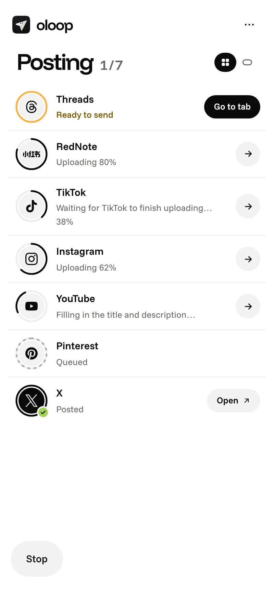
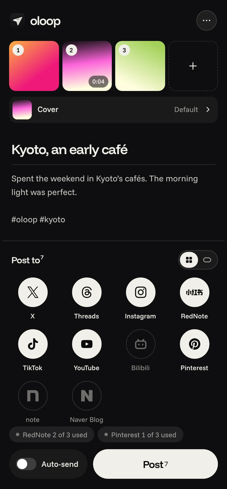

<p align="center">
  
</p>

<h1 align="center">oloop</h1>

<p align="center">
  Social media on autopilot.<br>
  A Chrome extension that posts one draft to ten platforms.<br>
  <a href="https://oloop.ooooomo.com">oloop.ooooomo.com</a>
</p>

<p align="center">
  
  
  
</p>

<p align="center">X · Threads · Instagram · RedNote · TikTok · YouTube · Bilibili · Pinterest · note · Naver Blog</p>

Write once in the side panel. oloop opens each platform's own composer in the browser you're signed into, uploads your media, fills everything in and waits until it's ready. X, Instagram and YouTube can post on their own; the others stop right before Post for you to press.

## Install

Until it's on the Chrome Web Store: download this repo, open `chrome://extensions`, turn on Developer mode, choose **Load unpacked** and pick the `extension` folder.

## Develop

```sh
npm i -D playwright && npx playwright install chromium
npm test
```

Each platform is one adapter in `extension/content/`. Translations are in `extension/lib/locales/`, the website in `site/`.

## License

[GPL-3.0](LICENSE)
